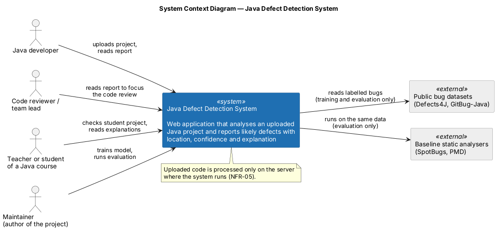
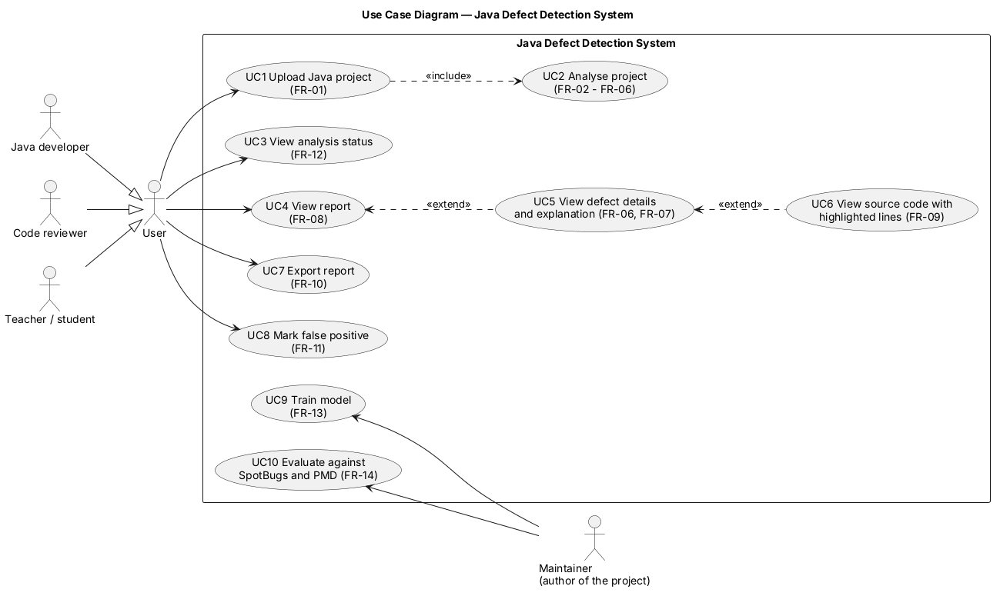
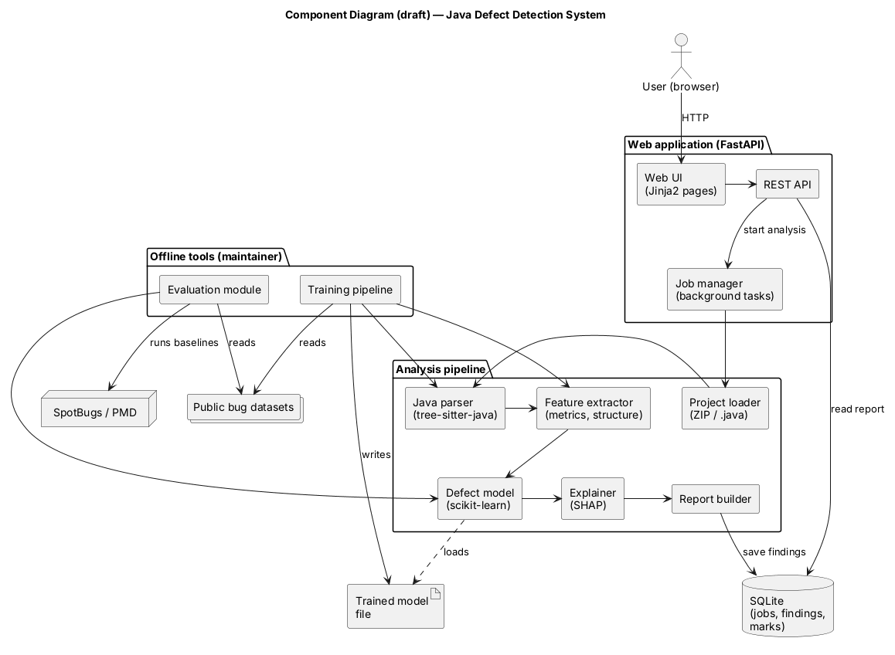
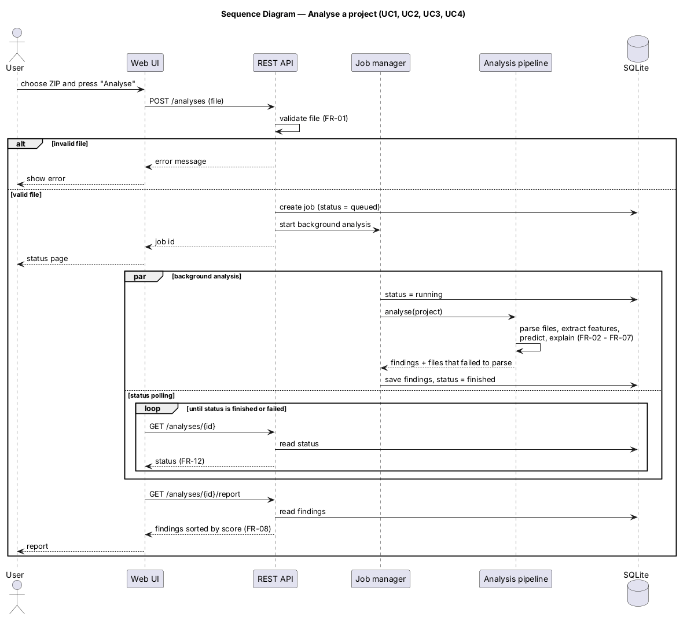
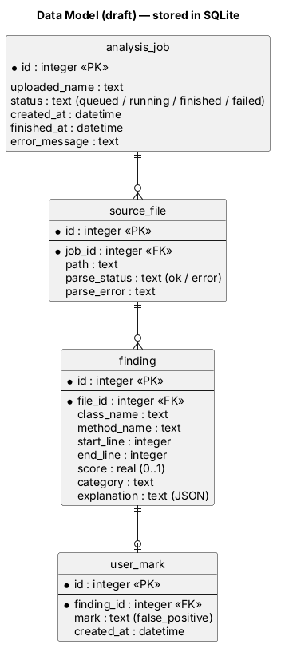

# Architecture

**Tasks:** DIP-15 (architecture), DIP-16 (diagrams), DIP-17 (data model)

**Status:** Draft

## 1. Overview

The system is a web application that runs on one computer. The user uploads a Java project in the browser, the analysis runs in the background, and then the user reads a report with likely defects, their location, a score and an explanation.

The system has two parts:

- **Online part:** the web application and the analysis pipeline, used by the users.
- **Offline part:** the training pipeline and the evaluation module, which train the model and compare it with SpotBugs and PMD. Only I (as the maintainer) use them.

The diagrams are in `diagrams/` as PlantUML sources with PNG and SVG images.

## 2. System context

Users work with the system through a browser. Public bug datasets (Defects4J, GitBug-Java) and the tools SpotBugs and PMD are used only for training and evaluation. Uploaded code stays on the computer where the system runs (NFR-05).

## 3. Use cases

| Use case | Actor | Requirements |
| --- | --- | --- |
| UC1 Upload Java project | User | FR-01 |
| UC2 Analyse project (included in UC1) | System | FR-02 to FR-06 |
| UC3 View analysis status | User | FR-12 |
| UC4 View report | User | FR-08 |
| UC5 View defect details and explanation | User | FR-06, FR-07 |
| UC6 View source code with highlighted lines | User | FR-09 |
| UC7 Export report | User | FR-10 |
| UC8 Mark false positive | User | FR-11 |
| UC9 Train model | Maintainer | FR-13 |
| UC10 Evaluate against SpotBugs and PMD | Maintainer | FR-14 |

## 4. Components

| Component | What it does | Technology |
| --- | --- | --- |
| Web UI | Pages for upload, status, report, defect details and code view | Jinja2 templates |
| REST API | Receives uploads, checks them, returns status and reports | FastAPI |
| Job manager | Runs each analysis in the background and updates its status | FastAPI background tasks |
| Project loader | Unpacks the ZIP archive and finds `.java` files | Python |
| Java parser | Builds a syntax tree for each file | tree-sitter-java |
| Feature extractor | Computes metrics, structural features and simple rule checks for each method (for example, a resource opened without try-with-resources); the rule checks also give the defect category | Python |
| Defect model | Gives each method a score from 0 to 1 | scikit-learn |
| Explainer | Finds the features that affected each score the most | SHAP |
| Report builder | Puts scores, locations and explanations together | Python |
| Storage | Stores jobs, files, findings and user marks | SQLite |
| Training pipeline (offline) | Builds the dataset and trains the model | Python, scikit-learn |
| Evaluation module (offline) | Runs the model, SpotBugs and PMD on the same data and computes metrics | Python |

The parser and the feature extractor are shared by the web application and the training pipeline, so features are always computed the same way.

## 5. Main scenario: analyse a project

1. The user selects a ZIP archive and starts the analysis.
2. The API checks the file. A bad file is rejected with a message.
3. The API creates a job with the status "queued" and starts a background task.
4. The pipeline parses the files, computes features, predicts scores, explains them and saves the results.
5. Meanwhile, the page asks for the job status every few seconds.
6. When the job is finished, the page shows the results sorted by score.

## 6. Data model

| Table | Content |
| --- | --- |
| `analysis_job` | One analysis: file name, status, times, error message |
| `source_file` | Each Java file of the job and whether it was parsed |
| `finding` | A likely defect: class, method, lines, score, category, explanation |
| `user_mark` | A user's mark on a finding, for example "false positive" |

Uploaded files and results are deleted after 24 hours (NFR-05).

## 7. Requirements and components

| Requirement | Components |
| --- | --- |
| FR-01 Upload | Web UI, REST API, Project loader |
| FR-02 Parse | Java parser |
| FR-03 Features | Feature extractor |
| FR-04 Score | Defect model |
| FR-05 Category | Feature extractor, Report builder |
| FR-06 Location | Java parser, Report builder |
| FR-07 Explanation | Explainer, Web UI |
| FR-08 Report | REST API, Storage, Web UI |
| FR-09 Code view | Web UI, Storage |
| FR-10 Export | REST API |
| FR-11 False positive mark | Web UI, REST API, Storage |
| FR-12 Status | Job manager, Storage, Web UI |
| FR-13 Training | Training pipeline, Java parser, Feature extractor |
| FR-14 Evaluation | Evaluation module, Defect model |
