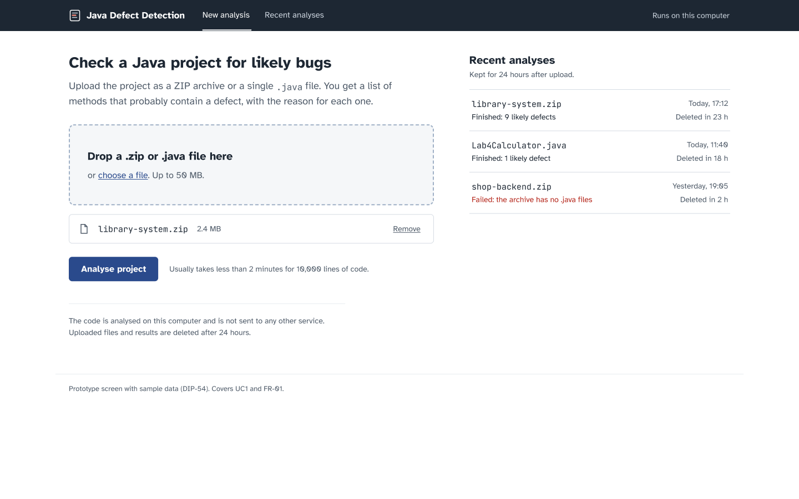
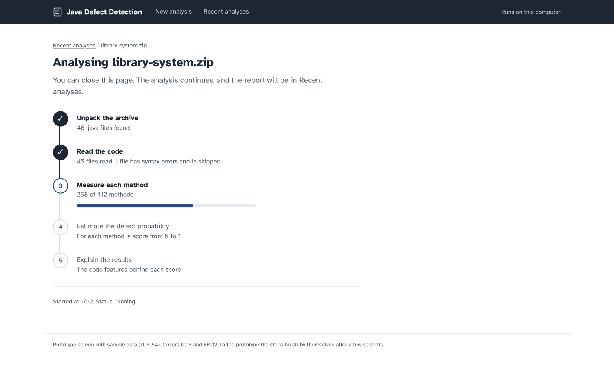
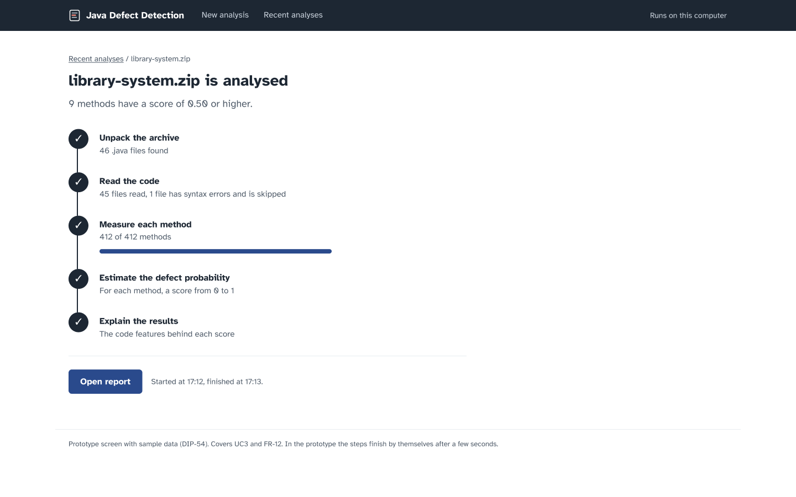
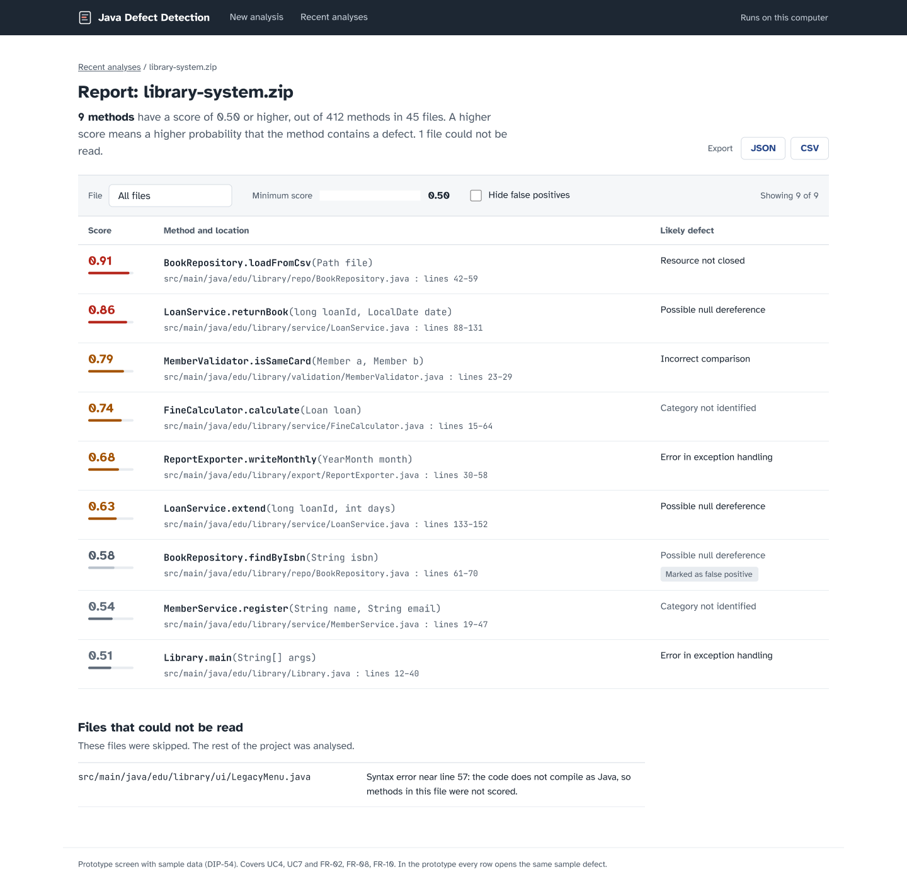
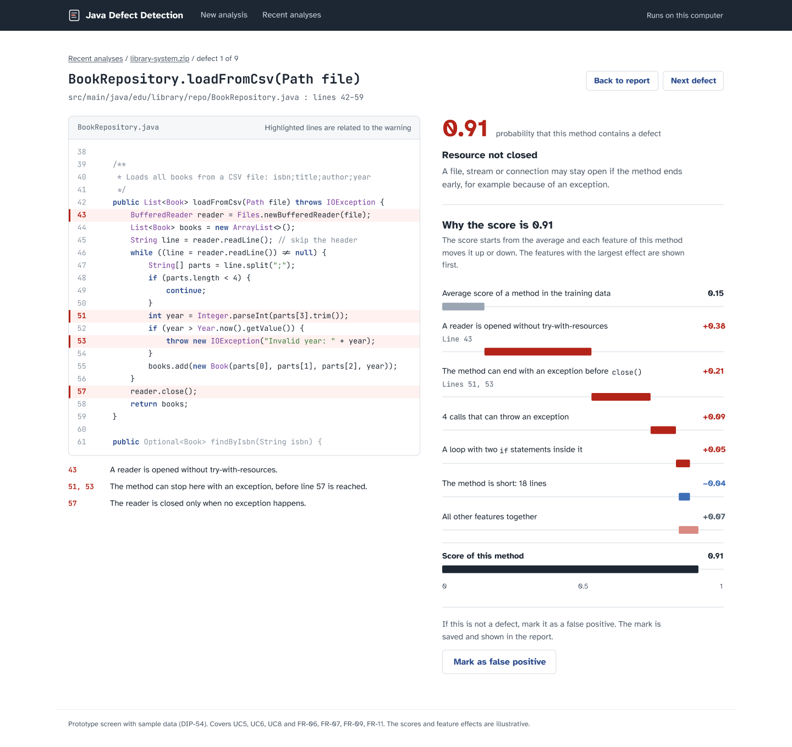

# Prototype of the web interface

**Task:** DIP-54

**Status:** Draft. The screens use sample data; scores and explanations are not real results.

The prototype is made in Figma. It shows the main user scenario: upload a project, wait for the analysis, read the report and open one defect with its explanation.

- Figma file: https://www.figma.com/design/pSddtE9uL8kJwAsBiiZxbe/Java-Defect-Detection---Prototype
- Clickable prototype (starts from "1 Upload"): https://www.figma.com/proto/pSddtE9uL8kJwAsBiiZxbe/Java-Defect-Detection---Prototype?node-id=1-2&starting-point-node-id=1-2

The PNG files in this folder are exported from the Figma frames.

## Scenario

1. **Upload:** the user chooses `library-system.zip` and clicks "Analyse project".
2. **Status, running:** the steps of the analysis are shown one by one. In the prototype the next screen opens after 3 seconds.
3. **Status, finished:** the user clicks "Open report".
4. **Report:** the user clicks a method in the list.
5. **Defect details:** the user reads the explanation and can go back to the report.

## Screens

| Screen | File | Use cases | Requirements |
| --- | --- | --- | --- |
| 1 Upload | `1-upload.png` | UC1 | FR-01 |
| 2 Status, running | `2-status-running.png` | UC3 | FR-12 |
| 3 Status, finished | `3-status-finished.png` | UC3 | FR-12 |
| 4 Report | `4-report.png` | UC4, UC7 | FR-02, FR-08, FR-10 |
| 5 Defect details | `5-defect-details.png` | UC5, UC6, UC8 | FR-05, FR-06, FR-07, FR-09, FR-11 |

### 1 Upload

The user chooses a ZIP archive or a `.java` file. The page also lists recent analyses.

### 2 and 3 Analysis status

The steps of the analysis are shown one by one, with progress for the current step. When the analysis is finished, the "Open report" button appears.

### 4 Report

Methods are sorted by score. The user can filter by file and minimum score, hide false positives and export the report as JSON or CSV. Files that could not be parsed are listed at the bottom.

### 5 Defect details

The page shows the code with the related lines highlighted, the score, the defect category and the explanation. The explanation starts from the average score and shows how much each code feature raised or lowered it (this is how SHAP values work). The user can mark the result as a false positive.

## How the screens were made

I first wrote the screens as simple HTML pages with sample data and imported them into Figma with the html.to.design plugin. The links between the screens were added in the Prototype mode of Figma.
